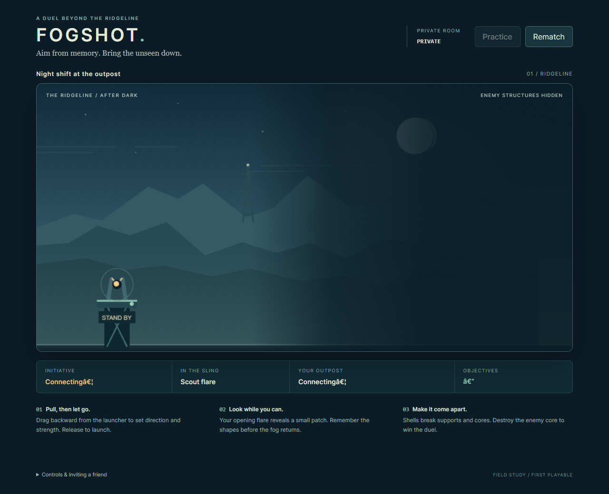
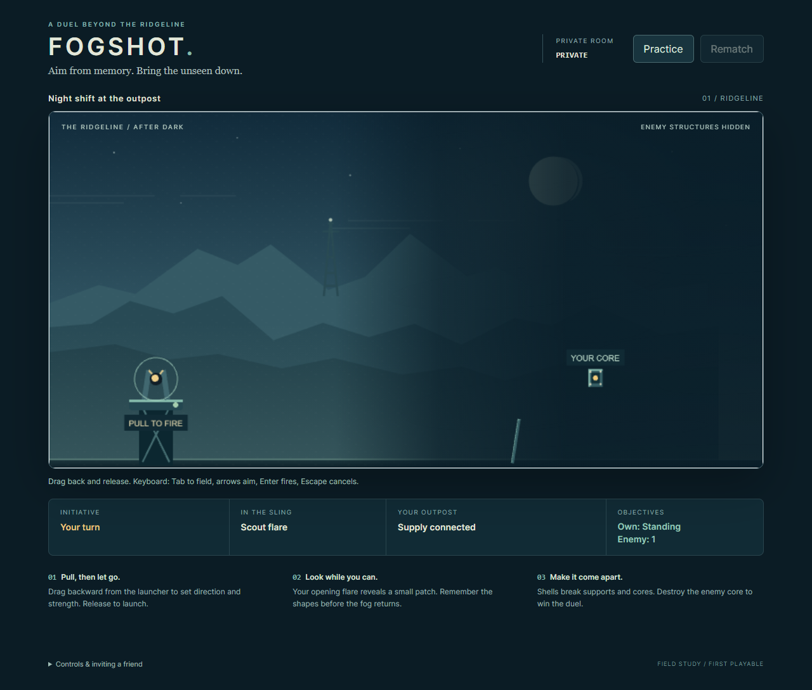
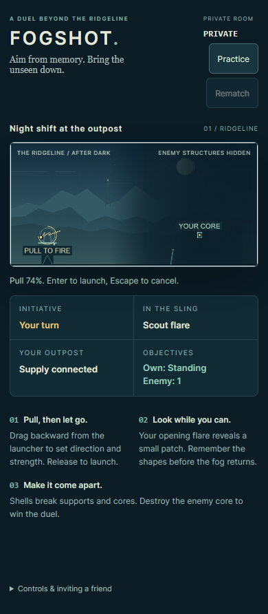

# First-play launch guidance - 2026-10-15

Live main and PRs 8/9 were refreshed before work. Main remained `81bb802433a9049b23c80af8e82433aff6e4b953`, PR8 remained `70d289babbb9353f4bb906cbc6d135c02de6655a`, and PR9 remained `238e8b51dbc9f4f8a2d7a6fac6f20d1e483df744`. This isolated branch starts from that exact reviewed practice head.

## Scope found by inspection

PR9 already supplies concise Practice entry, normal pull/release instructions, readable turns/objectives/results, owner reload, Multiplayer return and finished-only Rematch. Independent design review agreed these should be preserved. Mid-match reset, another entry screen and a tutorial modal were not warranted.

Two actual first-play gaps were reproduced: keyboard pull feedback was updated inside closed Controls details, and initial turn/supply/objective placeholders contained mojibake. The focused browser regression failed with all five expected symptoms: three damaged placeholders, hidden help and no accessible field description.

The existing unique pull hint now sits directly below the field, with Tab/arrows/Enter/Escape guidance and `aria-describedby` from the focusable battlefield. A polite status exposes changing keyboard pull feedback. Cancel, submission, pointer switching, epoch changes and turn loss clear obsolete launch guidance; same-turn polls preserve an active pull. Loading labels use plain ASCII. Bot policy, server/physics, dependencies and assets are outside this change.

## Verification

- Affected `jac check client/battlefield.jac` passed; imported server modules were interface-checked only.
- All 16 existing Node client tests passed.
- Actual Chrome presentation checks passed at desktop and 390 px: loading labels, visible/accessibly linked help, Tab focus order, arrow feedback, Escape cancellation, touch/multiple-pointer/outside cancellation, keyboard/pointer switching, turn-loss reset, real keyboard launch, reveal expiry and reduced motion.
- Actual practice lifecycle and two-seat suites passed, including both winners, rematch, reload, privacy and return to multiplayer.
- Independent code review found the existing multiplayer reader selected the first paragraph, now the control strip. It now selects `#fogshot-caption`; all semantic/gameplay assertions are preserved. Final code/design review reported no remaining blockers.

One final capture attempt timed out at Playwright's screenshot step after an HMR update. That failure is retained outside the repository. The exact final source passed after the server settled. Startup tests temporarily hold the genuine join request, inspect the initial UI, then forward it unchanged. Their elapsed startup measurements include that deliberate hold and screenshots, so they are explicitly labeled `startupHeldForChecks` and are not loading benchmarks.

Local checks remained focused while TravOS owned the heavy Windows slot. No full local Jac suite or sealed rebuild was repeated. The branch's normal clean Linux CI performs the full required source/sealed workflow; its PR checks are the final-head source of truth.

## Captures

Room display and caption are masked; no tokens, private room files or raw authenticated logs are committed. [Image hashes and check summary](evidence/first-play-2026-10-15/evidence.json).

Before, during loading:

After, ready to play:

## Handoff

The separate source preview uses http://127.0.0.1:8184/ (API 8185). Existing previews at 8180 and 8182 and frozen PR heads are preserved. This is a presentation-only review candidate. Screen-reader hardware, real mobile devices and long soak behavior remain unqualified; no new deployment or production-readiness claim is made. No paid calls, credentials, purchases or new dependencies.
