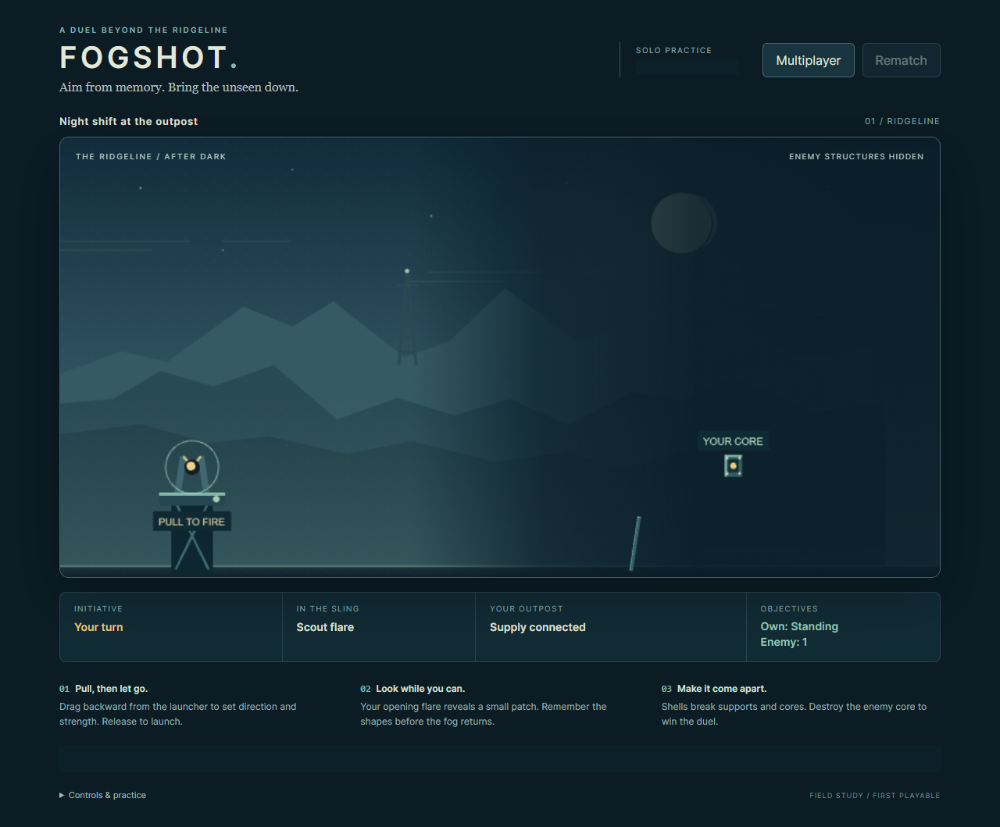
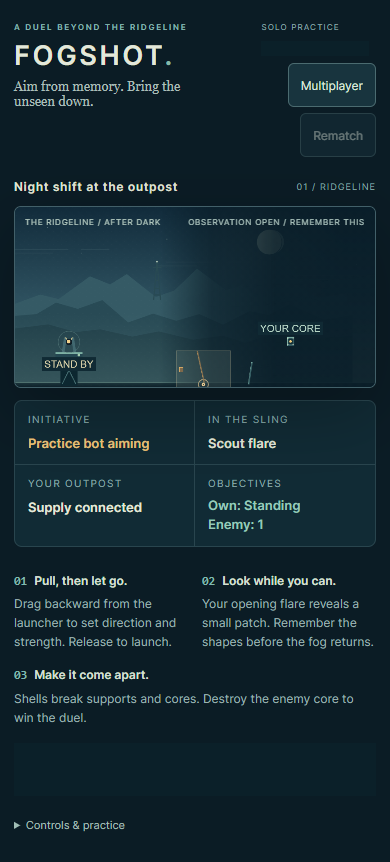

# Practice bot - 2026-10-15

A playable solo opponent is implemented on `codex/fogshot-practice-bot-20261015`, based on reviewed visual/packaging head `70d289babbb9353f4bb906cbc6d135c02de6655a`. Draft [PR #9](https://github.com/CosmonautJones/fogshot/pull/9) is stacked on PR8's frozen branch. PR8, main and the existing port 8180 playtest are unchanged. The tested application code checkpoint is `039a1dfc95bf057e610e72c85d2c60abfb9f4c03`; the subsequent checkpoint contains documentation and sanitized evidence only.

## Playing

Open the separate local sealed candidate at http://127.0.0.1:8182/?practice=1, or choose **Practice** from a multiplayer room. One human A faces one bot B. Pull backward from the launcher and release inside the field; pulling farther/down gives a stronger/higher shot. Tab to the battlefield, arrows adjust the pull, Enter fires and Escape cancels. Opening shots are scout flares; then alternate shells. **Rematch** starts a new generation after a result, and **Multiplayer** leaves practice. Reload reopens the owner's same practice room.

The bot waits until the human reveal closes plus 400 ms (at least 1200 ms total). It advances when the owner polls; closing the page pauses advancement until reconnect. There is one basic difficulty, with intentionally imperfect aim.

## Fair decision boundary and durability

The pure seat B policy accepts a copied ordinary seat observation and its own bounded remembered points. It never receives a LiveMatch, physics world, canonical bodies, health, hidden seed or owner identity. It scouts with the normal flare, remembers up to eight coarse positions actually exposed by its own active reveal, and chooses imperfect legal pulls using public free-flight estimates. Epoch changes clear memory. No model calls, new dependencies or generated assets were added.

Practice rooms reserve A and B for one authenticated owner. Plans use normal `take_shot` validation, stable epoch/turn/revision command IDs and per-room serialization. Plans, memory and due times persist in the same atomic canonical snapshot as gameplay. Failure rolls state back; rematch persists the new epoch. Repeated creation reuses the owner's room. A sibling staging directory is fully initialized before an atomic rename publishes a code-shaped room under its lookup lock.

The pull gauge now spans the reachable gesture envelope. Server power, submitted coordinates and physics remain unchanged. The existing original moonlit assets are preserved; see [art provenance](../assets/README.md).

## Verification

All checks used pinned Jac 0.37.23, Pymunk 7.3.0 and Playwright 1.55.1 with installed Chrome locally. Source and packaged servers were tested sequentially on isolated ports. No competing interactive browser or heavy Windows verification suite was started.

| Check | Actual result |
| --- | --- |
| `jac test tests/*_tests.jac -v` | 65 passed (original 50, five policy, ten practice) |
| Whole-program `jac check` | Passed; style warnings remain |
| Node playback/room/presentation tests | 16 passed |
| Actual source HTTP/browser suites | shot race, two-seat, presentation and practice passed |
| `jac build` + sealed-entry guard | Passed; 3,794,199-byte JAB |
| Actual sealed HTTP/browser suites | All four passed on the packaged single-port app |
| Independent code/design review | Actionable findings repaired; final review found no remaining blockers |

Practice browser coverage exercises an unavailable invite to Practice, reload during the full protected reveal, three concurrent real HTTP polls at the bot deadline, intruder rejection, a delayed genuine old response arriving after the bot move, both winners, rematches, 390 px layout and returning to multiplayer. Existing multiplayer tests still exercise both seats' wins, rematches and hidden-data boundaries. Presentation tests exercise touch cancellation, extra pointers, outside release, keyboard/pointer switching, local reveal expiry without polling and reduced motion.

Two publication regressions failed before repair and pass afterward: concurrent lookup cannot enter a half-created room; failed initial canonical write publishes no joinable room. Removing the stale-response guard reproduced rejection of the next real human shot; restoring it passed. Review also repaired unavailable-invite switching, failed-release recovery and old exception captions. Multiplayer caption checks now use each seat's Victory/Outpost lost status. The race test permits the existing actor rejection only for the exact rejected A/turn1/revision1 state; exactly one accepted shot and quiet-room invariants remain.

Earlier backend-only CI checkpoints failed on that serialized actor outcome before the test was corrected. The final candidate is subject to PR9's complete clean Linux source/sealed workflow; the PR check is the source of truth for final-head CI.

The locally tested JAB SHA256 is `5a3986855d9e24c8ef067b0af4dda27224b96d47a6d81ee006df46b4a5a9006b`. Sealed Chrome measured game ready around 833 ms; 120 active-effect frames had median 16.7 ms and p95 16.8 ms, with no page errors. These are local measurements, not hosting qualification.

## Sanitized packaged-game captures

Room display and live caption are masked at capture time. No tokens, room databases or raw authenticated network logs are committed. [Machine-readable measurements and image hashes](evidence/practice-2026-10-15/evidence.json).

[Human victory](evidence/practice-2026-10-15/practice-victory.png) / [Bot victory](evidence/practice-2026-10-15/practice-loss.png).

## Remaining limits

This retains the small first-playable siege fixture and one basic opponent. It is not balanced for competitive play. Memory is approximate; public free-flight estimates do not model hidden collisions. Browser account storage still follows the existing Jac authentication model. Only a single server process with two request threads was qualified: the room locks are in-process, so this is not a multiworker/distributed-hosting qualification. Real-device mobile/GPU variation and long soak tests remain unqualified. The repository distribution license remains an owner decision. No merge, deployment, spending or production-readiness claim.
